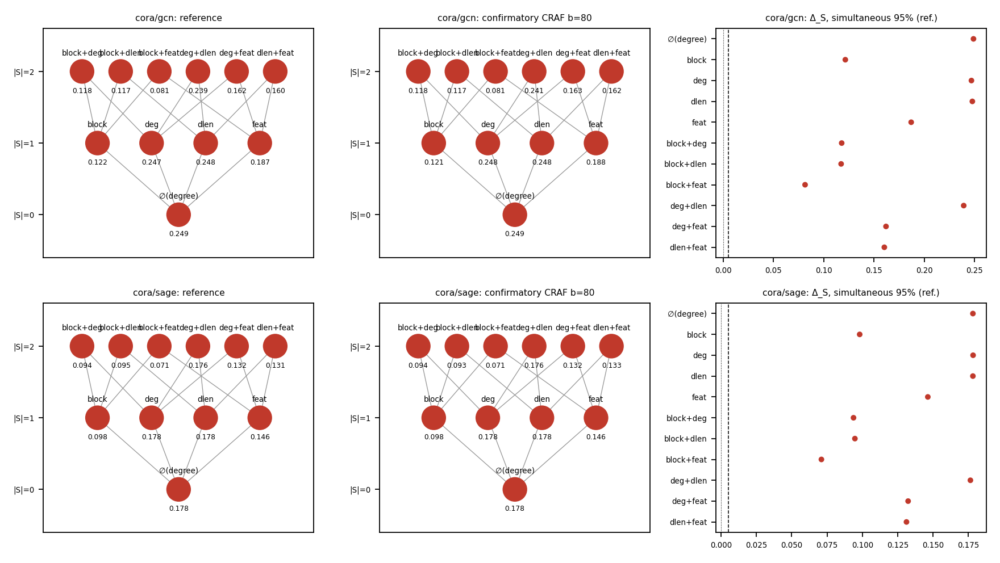

# phase3b report (generated from outputs/phase3b/analysis)

delta = 0.005, alpha = 0.05, confirmatory b = 80 (block 0); reference = clusters >= 100.

## 1. Admissibility (label-free, before any fit)

### cora

| element | n_joint_strata | acceptance | mean_overlap | mean_pairwise_overlap | mean_gen_seconds | admissible_final |
|---|---|---|---|---|---|---|
| degree | 1 | 1.000 | 0.008 | 0.009 | 0.037 | True |
| strat:block | 8 | 1.000 | 0.146 | 0.125 | 0.010 | True |
| strat:deg | 4 | 1.000 | 0.022 | 0.014 | 0.013 | True |
| strat:dlen | 4 | 1.000 | 0.015 | 0.016 | 0.015 | True |
| strat:feat | 8 | 1.000 | 0.051 | 0.047 | 0.031 | True |
| strat:block+deg | 32 | 1.000 | 0.190 | 0.160 | 0.048 | True |
| strat:block+dlen | 32 | 1.000 | 0.189 | 0.172 | 0.054 | True |
| strat:block+feat | 64 | 1.000 | 0.290 | 0.263 | 0.099 | True |
| strat:deg+dlen | 16 | 1.000 | 0.066 | 0.055 | 0.096 | True |
| strat:deg+feat | 32 | 1.000 | 0.187 | 0.174 | 0.261 | True |
| strat:dlen+feat | 32 | 1.000 | 0.193 | 0.183 | 0.299 | True |
| er | 1 | 1.000 | 0.002 | 0.002 | 0.004 | True |

## 2. Matched baselines (reference clusters; test 1 − Brier/2 and accuracy)

| dataset | model | variant | metric | mean | se | n |
|---|---|---|---|---|---|---|
| cora | gcn | empty | test_score | 0.6987 | 0.0002 | 1400 |
| cora | gcn | empty | test_acc | 0.5654 | 0.0005 | 1400 |
| cora | gcn | real | test_score | 0.8381 | 0.0002 | 1400 |
| cora | gcn | real | test_acc | 0.8009 | 0.0004 | 1400 |
| cora | gcn | mlp | test_score | 0.6987 | 0.0002 | 1400 |
| cora | gcn | mlp | test_acc | 0.5654 | 0.0005 | 1400 |
| cora | sage | empty | test_score | 0.6987 | 0.0002 | 1400 |
| cora | sage | empty | test_acc | 0.5656 | 0.0005 | 1400 |
| cora | sage | real | test_score | 0.8355 | 0.0002 | 1400 |
| cora | sage | real | test_acc | 0.7842 | 0.0004 | 1400 |
| cora | sage | mlp | test_score | 0.6987 | 0.0002 | 1400 |
| cora | sage | mlp | test_acc | 0.5654 | 0.0005 | 1400 |

## 3. Frontiers

Reference = all clusters >= block (mean over draws), Holm at alpha; simultaneous (Bonferroni) 95% intervals. Confirmatory = block 0, uniform CRAF at b_conf (primary) and adaptive CRAF (secondary).

### cora / gcn

Reference:

| element | n | delta_hat | se | sim_lo | sim_hi | status | cert_min | possible_min | gap_set |
|---|---|---|---|---|---|---|---|---|---|
| degree | 1400 | 0.2489 | 0.0002 | 0.2484 | 0.2495 | advantage | False | False |  |
| strat:block | 1400 | 0.1215 | 0.0002 | 0.1209 | 0.1221 | advantage | False | False |  |
| strat:deg | 1400 | 0.2469 | 0.0002 | 0.2463 | 0.2475 | advantage | False | False |  |
| strat:dlen | 1400 | 0.2478 | 0.0002 | 0.2472 | 0.2484 | advantage | False | False |  |
| strat:feat | 1400 | 0.1870 | 0.0002 | 0.1864 | 0.1876 | advantage | False | False |  |
| strat:block+deg | 1400 | 0.1179 | 0.0002 | 0.1173 | 0.1184 | advantage | False | False |  |
| strat:block+dlen | 1400 | 0.1173 | 0.0002 | 0.1167 | 0.1179 | advantage | False | False |  |
| strat:block+feat | 1400 | 0.0815 | 0.0002 | 0.0809 | 0.0820 | advantage | False | False |  |
| strat:deg+dlen | 1400 | 0.2392 | 0.0002 | 0.2386 | 0.2398 | advantage | False | False |  |
| strat:deg+feat | 1400 | 0.1619 | 0.0002 | 0.1613 | 0.1626 | advantage | False | False |  |
| strat:dlen+feat | 1400 | 0.1603 | 0.0002 | 0.1597 | 0.1609 | advantage | False | False |  |

Confirmatory (uniform CRAF, b = 80):

| element | delta_hat | sim_lo | sim_hi | p_adv | p_suf | status | cert_min | possible_min | min_among_cert | gap_set |
|---|---|---|---|---|---|---|---|---|---|---|
| degree | 0.2495 | 0.2470 | 0.2520 | 0.0000 | 1.0000 | advantage | False | False | False |  |
| strat:block | 0.1214 | 0.1188 | 0.1239 | 0.0000 | 1.0000 | advantage | False | False | False |  |
| strat:deg | 0.2475 | 0.2448 | 0.2502 | 0.0000 | 1.0000 | advantage | False | False | False |  |
| strat:dlen | 0.2478 | 0.2454 | 0.2501 | 0.0000 | 1.0000 | advantage | False | False | False |  |
| strat:feat | 0.1875 | 0.1846 | 0.1905 | 0.0000 | 1.0000 | advantage | False | False | False |  |
| strat:block+deg | 0.1182 | 0.1154 | 0.1210 | 0.0000 | 1.0000 | advantage | False | False | False |  |
| strat:block+dlen | 0.1175 | 0.1148 | 0.1202 | 0.0000 | 1.0000 | advantage | False | False | False |  |
| strat:block+feat | 0.0809 | 0.0785 | 0.0833 | 0.0000 | 1.0000 | advantage | False | False | False |  |
| strat:deg+dlen | 0.2411 | 0.2387 | 0.2435 | 0.0000 | 1.0000 | advantage | False | False | False |  |
| strat:deg+feat | 0.1628 | 0.1600 | 0.1656 | 0.0000 | 1.0000 | advantage | False | False | False |  |
| strat:dlen+feat | 0.1617 | 0.1592 | 0.1643 | 0.0000 | 1.0000 | advantage | False | False | False |  |

### cora / sage

Reference:

| element | n | delta_hat | se | sim_lo | sim_hi | status | cert_min | possible_min | gap_set |
|---|---|---|---|---|---|---|---|---|---|
| degree | 1400 | 0.1782 | 0.0002 | 0.1775 | 0.1789 | advantage | False | False |  |
| strat:block | 1400 | 0.0981 | 0.0002 | 0.0974 | 0.0987 | advantage | False | False |  |
| strat:deg | 1400 | 0.1784 | 0.0002 | 0.1777 | 0.1791 | advantage | False | False |  |
| strat:dlen | 1400 | 0.1782 | 0.0002 | 0.1775 | 0.1789 | advantage | False | False |  |
| strat:feat | 1400 | 0.1463 | 0.0002 | 0.1456 | 0.1470 | advantage | False | False |  |
| strat:block+deg | 1400 | 0.0937 | 0.0002 | 0.0931 | 0.0943 | advantage | False | False |  |
| strat:block+dlen | 1400 | 0.0947 | 0.0002 | 0.0941 | 0.0953 | advantage | False | False |  |
| strat:block+feat | 1400 | 0.0710 | 0.0002 | 0.0704 | 0.0716 | advantage | False | False |  |
| strat:deg+dlen | 1400 | 0.1765 | 0.0002 | 0.1758 | 0.1772 | advantage | False | False |  |
| strat:deg+feat | 1400 | 0.1324 | 0.0002 | 0.1317 | 0.1330 | advantage | False | False |  |
| strat:dlen+feat | 1400 | 0.1312 | 0.0002 | 0.1306 | 0.1319 | advantage | False | False |  |

Confirmatory (uniform CRAF, b = 80):

| element | delta_hat | sim_lo | sim_hi | p_adv | p_suf | status | cert_min | possible_min | min_among_cert | gap_set |
|---|---|---|---|---|---|---|---|---|---|---|
| degree | 0.1780 | 0.1750 | 0.1810 | 0.0000 | 1.0000 | advantage | False | False | False |  |
| strat:block | 0.0983 | 0.0957 | 0.1009 | 0.0000 | 1.0000 | advantage | False | False | False |  |
| strat:deg | 0.1784 | 0.1750 | 0.1818 | 0.0000 | 1.0000 | advantage | False | False | False |  |
| strat:dlen | 0.1780 | 0.1749 | 0.1812 | 0.0000 | 1.0000 | advantage | False | False | False |  |
| strat:feat | 0.1458 | 0.1425 | 0.1490 | 0.0000 | 1.0000 | advantage | False | False | False |  |
| strat:block+deg | 0.0938 | 0.0907 | 0.0969 | 0.0000 | 1.0000 | advantage | False | False | False |  |
| strat:block+dlen | 0.0931 | 0.0903 | 0.0959 | 0.0000 | 1.0000 | advantage | False | False | False |  |
| strat:block+feat | 0.0713 | 0.0685 | 0.0741 | 0.0000 | 1.0000 | advantage | False | False | False |  |
| strat:deg+dlen | 0.1763 | 0.1729 | 0.1798 | 0.0000 | 1.0000 | advantage | False | False | False |  |
| strat:deg+feat | 0.1322 | 0.1293 | 0.1351 | 0.0000 | 1.0000 | advantage | False | False | False |  |
| strat:dlen+feat | 0.1329 | 0.1296 | 0.1361 | 0.0000 | 1.0000 | advantage | False | False | False |  |

### Frontier summary

| dataset | model | run | cert_min | possible_min | n_advantage | n_sufficient | n_inconclusive | specificity_over_L | min_among_cert | gaps |
|---|---|---|---|---|---|---|---|---|---|---|
| cora | gcn | reference | {} | {} | 11 | 0 | 0 | True | {} |  |
| cora | gcn | confirm craf | {} | {} | 11 | 0 | 0 | True | {} |  |
| cora | gcn | confirm craf_adaptive | {} | {} | 11 | 0 | 0 | True | {} |  |
| cora | sage | reference | {} | {} | 11 | 0 | 0 | True | {} |  |
| cora | sage | confirm craf | {} | {} | 11 | 0 | 0 | True | {} |  |
| cora | sage | confirm craf_adaptive | {} | {} | 11 | 0 | 0 | True | {} |  |



## 4. Confirmatory block: what each procedure reports (same data, same budget)

| dataset | model | procedure | reported | fits | n_A | n_C | n_inconclusive |
|---|---|---|---|---|---|---|---|
| cora | gcn | craf | {} | 960 | 11 | 0 | 0 |
| cora | gcn | craf_children | {} | 960 | 11 | 0 | 0 |
| cora | gcn | factorial_unadj | {} | 960 | 11 | 0 | 0 |
| cora | gcn | ni_holm | {} | 960 | 0 | 0 | 11 |
| cora | gcn | naive_point | {} | 960 |  |  |  |
| cora | gcn | craf_adaptive | {} | 520 | 11 | 0 | 0 |
| cora | gcn | pcga_l | {} | 500 |  |  |  |
| cora | sage | craf | {} | 960 | 11 | 0 | 0 |
| cora | sage | craf_children | {} | 960 | 11 | 0 | 0 |
| cora | sage | factorial_unadj | {} | 960 | 11 | 0 | 0 |
| cora | sage | ni_holm | {} | 960 | 0 | 0 | 11 |
| cora | sage | naive_point | {} | 960 |  |  |  |
| cora | sage | craf_adaptive | {} | 520 | 11 | 0 | 0 |
| cora | sage | pcga_l | {} | 500 |  |  |  |

## 5. Resampling comparison (disjoint reference blocks; leave-block-out reference truth)

| dataset | model | b | procedure | n_exp | exact | false_member | false_member_hi | class_error | class_error_hi | covered | n_inconclusive | unc_size | mean_fits | modal_report |
|---|---|---|---|---|---|---|---|---|---|---|---|---|---|---|
| cora | gcn | 20 | craf | 14 | 1.000 | 0.000 | 0.215 | 0.000 | 0.215 | 1.000 | 0.000 | 0.000 | 240.000 | {} |
| cora | gcn | 20 | craf_adaptive | 14 | 1.000 | 0.000 | 0.215 | 0.000 | 0.215 | 1.000 | 0.000 | 0.000 | 239.929 | {} |
| cora | gcn | 20 | craf_children | 14 | 1.000 | 0.000 | 0.215 | 0.000 | 0.215 |  | 0.000 |  | 240.000 | {} |
| cora | gcn | 20 | ni_holm | 14 | 1.000 | 0.000 | 0.215 | 0.000 | 0.215 |  | 11.000 |  | 240.000 | {} |
| cora | gcn | 20 | factorial_unadj | 14 | 1.000 | 0.000 | 0.215 | 0.000 | 0.215 |  | 0.000 |  | 240.000 | {} |
| cora | gcn | 20 | naive_point | 14 | 1.000 | 0.000 | 0.215 |  |  |  |  |  | 240.000 | {} |
| cora | gcn | 20 | pcga_l | 14 | 1.000 | 0.000 | 0.215 |  |  |  |  |  | 240.000 | {} |
| cora | gcn | 40 | craf | 14 | 1.000 | 0.000 | 0.215 | 0.000 | 0.215 | 1.000 | 0.000 | 0.000 | 480.000 | {} |
| cora | gcn | 40 | craf_adaptive | 14 | 1.000 | 0.000 | 0.215 | 0.000 | 0.215 | 1.000 | 0.000 | 0.000 | 380.000 | {} |
| cora | gcn | 40 | craf_children | 14 | 1.000 | 0.000 | 0.215 | 0.000 | 0.215 |  | 0.000 |  | 480.000 | {} |
| cora | gcn | 40 | ni_holm | 14 | 1.000 | 0.000 | 0.215 | 0.000 | 0.215 |  | 11.000 |  | 480.000 | {} |
| cora | gcn | 40 | factorial_unadj | 14 | 1.000 | 0.000 | 0.215 | 0.000 | 0.215 |  | 0.000 |  | 480.000 | {} |
| cora | gcn | 40 | naive_point | 14 | 1.000 | 0.000 | 0.215 |  |  |  |  |  | 480.000 | {} |
| cora | gcn | 40 | pcga_l | 14 | 1.000 | 0.000 | 0.215 |  |  |  |  |  | 480.000 | {} |
| cora | gcn | 80 | craf | 14 | 1.000 | 0.000 | 0.215 | 0.000 | 0.215 | 1.000 | 0.000 | 0.000 | 960.000 | {} |
| cora | gcn | 80 | craf_adaptive | 14 | 1.000 | 0.000 | 0.215 | 0.000 | 0.215 | 1.000 | 0.000 | 0.000 | 520.000 | {} |
| cora | gcn | 80 | craf_children | 14 | 1.000 | 0.000 | 0.215 | 0.000 | 0.215 |  | 0.000 |  | 960.000 | {} |
| cora | gcn | 80 | ni_holm | 14 | 1.000 | 0.000 | 0.215 | 0.000 | 0.215 |  | 11.000 |  | 960.000 | {} |
| cora | gcn | 80 | factorial_unadj | 14 | 1.000 | 0.000 | 0.215 | 0.000 | 0.215 |  | 0.000 |  | 960.000 | {} |
| cora | gcn | 80 | naive_point | 14 | 1.000 | 0.000 | 0.215 |  |  |  |  |  | 960.000 | {} |
| cora | gcn | 80 | pcga_l | 14 | 1.000 | 0.000 | 0.215 |  |  |  |  |  | 500.000 | {} |
| cora | sage | 20 | craf | 14 | 1.000 | 0.000 | 0.215 | 0.000 | 0.215 | 1.000 | 0.000 | 0.000 | 240.000 | {} |
| cora | sage | 20 | craf_adaptive | 14 | 1.000 | 0.000 | 0.215 | 0.000 | 0.215 | 1.000 | 0.000 | 0.000 | 239.714 | {} |
| cora | sage | 20 | craf_children | 14 | 1.000 | 0.000 | 0.215 | 0.000 | 0.215 |  | 0.000 |  | 240.000 | {} |
| cora | sage | 20 | ni_holm | 14 | 1.000 | 0.000 | 0.215 | 0.000 | 0.215 |  | 11.000 |  | 240.000 | {} |
| cora | sage | 20 | factorial_unadj | 14 | 1.000 | 0.000 | 0.215 | 0.000 | 0.215 |  | 0.000 |  | 240.000 | {} |
| cora | sage | 20 | naive_point | 14 | 1.000 | 0.000 | 0.215 |  |  |  |  |  | 240.000 | {} |
| cora | sage | 20 | pcga_l | 14 | 1.000 | 0.000 | 0.215 |  |  |  |  |  | 240.000 | {} |
| cora | sage | 40 | craf | 14 | 1.000 | 0.000 | 0.215 | 0.000 | 0.215 | 1.000 | 0.000 | 0.000 | 480.000 | {} |
| cora | sage | 40 | craf_adaptive | 14 | 1.000 | 0.000 | 0.215 | 0.000 | 0.215 | 1.000 | 0.000 | 0.000 | 380.214 | {} |
| cora | sage | 40 | craf_children | 14 | 1.000 | 0.000 | 0.215 | 0.000 | 0.215 |  | 0.000 |  | 480.000 | {} |
| cora | sage | 40 | ni_holm | 14 | 1.000 | 0.000 | 0.215 | 0.000 | 0.215 |  | 11.000 |  | 480.000 | {} |
| cora | sage | 40 | factorial_unadj | 14 | 1.000 | 0.000 | 0.215 | 0.000 | 0.215 |  | 0.000 |  | 480.000 | {} |
| cora | sage | 40 | naive_point | 14 | 1.000 | 0.000 | 0.215 |  |  |  |  |  | 480.000 | {} |
| cora | sage | 40 | pcga_l | 14 | 1.000 | 0.000 | 0.215 |  |  |  |  |  | 480.000 | {} |
| cora | sage | 80 | craf | 14 | 1.000 | 0.000 | 0.215 | 0.000 | 0.215 | 1.000 | 0.000 | 0.000 | 960.000 | {} |
| cora | sage | 80 | craf_adaptive | 14 | 1.000 | 0.000 | 0.215 | 0.000 | 0.215 | 1.000 | 0.000 | 0.000 | 520.143 | {} |
| cora | sage | 80 | craf_children | 14 | 1.000 | 0.000 | 0.215 | 0.000 | 0.215 |  | 0.000 |  | 960.000 | {} |
| cora | sage | 80 | ni_holm | 14 | 1.000 | 0.000 | 0.215 | 0.000 | 0.215 |  | 11.000 |  | 960.000 | {} |
| cora | sage | 80 | factorial_unadj | 14 | 1.000 | 0.000 | 0.215 | 0.000 | 0.215 |  | 0.000 |  | 960.000 | {} |
| cora | sage | 80 | naive_point | 14 | 1.000 | 0.000 | 0.215 |  |  |  |  |  | 960.000 | {} |
| cora | sage | 80 | pcga_l | 14 | 1.000 | 0.000 | 0.215 |  |  |  |  |  | 500.000 | {} |

Paired differences (experiment-paired; normal 95% CI):

| dataset | model | b | a | b_proc | metric | diff | ci_lo | ci_hi | n_exp |
|---|---|---|---|---|---|---|---|---|---|
| cora | gcn | 20 | craf_adaptive | craf | exact | 0.000 | 0.000 | 0.000 | 14 |
| cora | gcn | 40 | craf_adaptive | craf | exact | 0.000 | 0.000 | 0.000 | 14 |
| cora | gcn | 80 | craf_adaptive | craf | exact | 0.000 | 0.000 | 0.000 | 14 |
| cora | sage | 20 | craf_adaptive | craf | exact | 0.000 | 0.000 | 0.000 | 14 |
| cora | sage | 40 | craf_adaptive | craf | exact | 0.000 | 0.000 | 0.000 | 14 |
| cora | sage | 80 | craf_adaptive | craf | exact | 0.000 | 0.000 | 0.000 | 14 |
| cora | gcn | 20 | craf_adaptive | craf | n_inconclusive | 0.000 | 0.000 | 0.000 | 14 |
| cora | gcn | 40 | craf_adaptive | craf | n_inconclusive | 0.000 | 0.000 | 0.000 | 14 |
| cora | gcn | 80 | craf_adaptive | craf | n_inconclusive | 0.000 | 0.000 | 0.000 | 14 |
| cora | sage | 20 | craf_adaptive | craf | n_inconclusive | 0.000 | 0.000 | 0.000 | 14 |
| cora | sage | 40 | craf_adaptive | craf | n_inconclusive | 0.000 | 0.000 | 0.000 | 14 |
| cora | sage | 80 | craf_adaptive | craf | n_inconclusive | 0.000 | 0.000 | 0.000 | 14 |
| cora | gcn | 20 | craf | ni_holm | false_member | 0.000 | 0.000 | 0.000 | 14 |
| cora | gcn | 40 | craf | ni_holm | false_member | 0.000 | 0.000 | 0.000 | 14 |
| cora | gcn | 80 | craf | ni_holm | false_member | 0.000 | 0.000 | 0.000 | 14 |
| cora | sage | 20 | craf | ni_holm | false_member | 0.000 | 0.000 | 0.000 | 14 |
| cora | sage | 40 | craf | ni_holm | false_member | 0.000 | 0.000 | 0.000 | 14 |
| cora | sage | 80 | craf | ni_holm | false_member | 0.000 | 0.000 | 0.000 | 14 |
| cora | gcn | 20 | craf | craf_children | false_member | 0.000 | 0.000 | 0.000 | 14 |
| cora | gcn | 40 | craf | craf_children | false_member | 0.000 | 0.000 | 0.000 | 14 |
| cora | gcn | 80 | craf | craf_children | false_member | 0.000 | 0.000 | 0.000 | 14 |
| cora | sage | 20 | craf | craf_children | false_member | 0.000 | 0.000 | 0.000 | 14 |
| cora | sage | 40 | craf | craf_children | false_member | 0.000 | 0.000 | 0.000 | 14 |
| cora | sage | 80 | craf | craf_children | false_member | 0.000 | 0.000 | 0.000 | 14 |
| cora | gcn | 20 | craf | naive_point | false_member | 0.000 | 0.000 | 0.000 | 14 |
| cora | gcn | 40 | craf | naive_point | false_member | 0.000 | 0.000 | 0.000 | 14 |
| cora | gcn | 80 | craf | naive_point | false_member | 0.000 | 0.000 | 0.000 | 14 |
| cora | sage | 20 | craf | naive_point | false_member | 0.000 | 0.000 | 0.000 | 14 |
| cora | sage | 40 | craf | naive_point | false_member | 0.000 | 0.000 | 0.000 | 14 |
| cora | sage | 80 | craf | naive_point | false_member | 0.000 | 0.000 | 0.000 | 14 |
| cora | gcn | 20 | craf | naive_point | exact | 0.000 | 0.000 | 0.000 | 14 |
| cora | gcn | 40 | craf | naive_point | exact | 0.000 | 0.000 | 0.000 | 14 |
| cora | gcn | 80 | craf | naive_point | exact | 0.000 | 0.000 | 0.000 | 14 |
| cora | sage | 20 | craf | naive_point | exact | 0.000 | 0.000 | 0.000 | 14 |
| cora | sage | 40 | craf | naive_point | exact | 0.000 | 0.000 | 0.000 | 14 |
| cora | sage | 80 | craf | naive_point | exact | 0.000 | 0.000 | 0.000 | 14 |

## 6. RUSA full-set claim (exhaustive IUT vs fullset_adaptive_fb; PCGA-L edge step for reference)

| dataset | model | b | procedure | n_exp | claim | false_vs_full | theta_full | fits | fallback |
|---|---|---|---|---|---|---|---|---|---|
| cora | gcn | 6 | exhaustive_iut | 14 | 1.000 | 0.000 | 0.081 | 84.000 |  |
| cora | gcn | 6 | fullset_adaptive_fb | 14 | 1.000 | 0.000 | 0.081 | 84.000 | 1.000 |
| cora | gcn | 6 | pcga_l | 14 | 1.000 | 0.000 | 0.081 | 80.000 |  |
| cora | gcn | 12 | exhaustive_iut | 14 | 1.000 | 0.000 | 0.081 | 168.000 |  |
| cora | gcn | 12 | fullset_adaptive_fb | 14 | 1.000 | 0.000 | 0.081 | 56.000 | 0.000 |
| cora | gcn | 12 | pcga_l | 14 | 1.000 | 0.000 | 0.081 | 165.000 |  |
| cora | gcn | 24 | exhaustive_iut | 14 | 1.000 | 0.000 | 0.081 | 336.000 |  |
| cora | gcn | 24 | fullset_adaptive_fb | 14 | 1.000 | 0.000 | 0.081 | 112.000 | 0.000 |
| cora | gcn | 24 | pcga_l | 14 | 1.000 | 0.000 | 0.081 | 335.000 |  |
| cora | sage | 6 | exhaustive_iut | 14 | 1.000 | 0.000 | 0.071 | 84.000 |  |
| cora | sage | 6 | fullset_adaptive_fb | 14 | 1.000 | 0.000 | 0.071 | 84.000 | 1.000 |
| cora | sage | 6 | pcga_l | 14 | 1.000 | 0.000 | 0.071 | 80.000 |  |
| cora | sage | 12 | exhaustive_iut | 14 | 1.000 | 0.000 | 0.071 | 168.000 |  |
| cora | sage | 12 | fullset_adaptive_fb | 14 | 1.000 | 0.000 | 0.071 | 56.000 | 0.000 |
| cora | sage | 12 | pcga_l | 14 | 1.000 | 0.000 | 0.071 | 165.000 |  |
| cora | sage | 24 | exhaustive_iut | 14 | 1.000 | 0.000 | 0.071 | 336.000 |  |
| cora | sage | 24 | fullset_adaptive_fb | 14 | 1.000 | 0.000 | 0.071 | 112.000 | 0.000 |
| cora | sage | 24 | pcga_l | 14 | 1.000 | 0.000 | 0.071 | 335.000 |  |

Confirmatory block:

| dataset | model | b | procedure | claim | L | theta_hat | fits |
|---|---|---|---|---|---|---|---|
| cora | gcn | 6 | pcga_l | True |  | 0.1234 | 80 |
| cora | gcn | 6 | exhaustive_iut | True | 0.0765 | 0.0830 | 84 |
| cora | gcn | 6 | fullset_adaptive_fb | True | 0.0765 | 0.0830 | 84 |
| cora | gcn | 12 | pcga_l | True |  | 0.1221 | 165 |
| cora | gcn | 12 | exhaustive_iut | True | 0.0796 | 0.0836 | 168 |
| cora | gcn | 12 | fullset_adaptive_fb | True | 0.0526 | 0.0715 | 56 |
| cora | gcn | 24 | pcga_l | True |  | 0.1215 | 335 |
| cora | gcn | 24 | exhaustive_iut | True | 0.0808 | 0.0835 | 336 |
| cora | gcn | 24 | fullset_adaptive_fb | True | 0.0659 | 0.0729 | 112 |
| cora | sage | 6 | pcga_l | True |  | 0.0988 | 80 |
| cora | sage | 6 | exhaustive_iut | True | 0.0634 | 0.0737 | 84 |
| cora | sage | 6 | fullset_adaptive_fb | True | 0.0634 | 0.0737 | 84 |
| cora | sage | 12 | pcga_l | True |  | 0.0994 | 165 |
| cora | sage | 12 | exhaustive_iut | True | 0.0676 | 0.0729 | 168 |
| cora | sage | 12 | fullset_adaptive_fb | True | 0.0501 | 0.0645 | 56 |
| cora | sage | 24 | pcga_l | True |  | 0.0991 | 335 |
| cora | sage | 24 | exhaustive_iut | True | 0.0700 | 0.0731 | 336 |
| cora | sage | 24 | fullset_adaptive_fb | True | 0.0597 | 0.0675 | 112 |

| dataset | model | b | diff_claim(fb − exhaustive) | ci_lo | ci_hi | n_exp |
|---|---|---|---|---|---|---|
| cora | gcn | 6 | 0.000 | 0.000 | 0.000 | 14 |
| cora | gcn | 12 | 0.000 | 0.000 | 0.000 | 14 |
| cora | gcn | 24 | 0.000 | 0.000 | 0.000 | 14 |
| cora | sage | 6 | 0.000 | 0.000 | 0.000 | 14 |
| cora | sage | 12 | 0.000 | 0.000 | 0.000 | 14 |
| cora | sage | 24 | 0.000 | 0.000 | 0.000 | 14 |

## 7. Calibration on fresh clusters (exact A/A contrasts; centred real contrasts secondary)

Marginal one-sided t size (pooled over elements):

| dataset | model | n | direction | alpha | tests | size | wilson_lo | wilson_hi | flag |
|---|---|---|---|---|---|---|---|---|---|
| cora | gcn | 5 | adv | 0.0023 | 3080 | 0.0032 | 0.0018 | 0.0060 | False |
| cora | gcn | 5 | adv | 0.0100 | 3080 | 0.0107 | 0.0076 | 0.0150 | False |
| cora | gcn | 5 | adv | 0.0500 | 3080 | 0.0490 | 0.0419 | 0.0572 | False |
| cora | gcn | 5 | suf | 0.0023 | 3080 | 0.0019 | 0.0009 | 0.0042 | False |
| cora | gcn | 5 | suf | 0.0100 | 3080 | 0.0091 | 0.0063 | 0.0131 | False |
| cora | gcn | 5 | suf | 0.0500 | 3080 | 0.0503 | 0.0431 | 0.0586 | False |
| cora | gcn | 10 | adv | 0.0023 | 1540 | 0.0006 | 0.0001 | 0.0037 | False |
| cora | gcn | 10 | adv | 0.0100 | 1540 | 0.0084 | 0.0049 | 0.0144 | False |
| cora | gcn | 10 | adv | 0.0500 | 1540 | 0.0487 | 0.0390 | 0.0606 | False |
| cora | gcn | 10 | suf | 0.0023 | 1540 | 0.0019 | 0.0007 | 0.0057 | False |
| cora | gcn | 10 | suf | 0.0100 | 1540 | 0.0097 | 0.0059 | 0.0160 | False |
| cora | gcn | 10 | suf | 0.0500 | 1540 | 0.0461 | 0.0367 | 0.0578 | False |
| cora | gcn | 20 | adv | 0.0023 | 770 | 0.0039 | 0.0013 | 0.0114 | False |
| cora | gcn | 20 | adv | 0.0100 | 770 | 0.0117 | 0.0062 | 0.0221 | False |
| cora | gcn | 20 | adv | 0.0500 | 770 | 0.0442 | 0.0318 | 0.0611 | False |
| cora | gcn | 20 | suf | 0.0023 | 770 | 0.0039 | 0.0013 | 0.0114 | False |
| cora | gcn | 20 | suf | 0.0100 | 770 | 0.0091 | 0.0044 | 0.0186 | False |
| cora | gcn | 20 | suf | 0.0500 | 770 | 0.0377 | 0.0263 | 0.0536 | False |
| cora | gcn | 40 | adv | 0.0023 | 385 | 0.0026 | 0.0005 | 0.0146 | False |
| cora | gcn | 40 | adv | 0.0100 | 385 | 0.0104 | 0.0040 | 0.0264 | False |
| cora | gcn | 40 | adv | 0.0500 | 385 | 0.0519 | 0.0339 | 0.0789 | False |
| cora | gcn | 40 | suf | 0.0023 | 385 | 0.0026 | 0.0005 | 0.0146 | False |
| cora | gcn | 40 | suf | 0.0100 | 385 | 0.0052 | 0.0014 | 0.0187 | False |
| cora | gcn | 40 | suf | 0.0500 | 385 | 0.0286 | 0.0160 | 0.0504 | False |
| cora | gcn | 80 | adv | 0.0023 | 187 | 0.0053 | 0.0009 | 0.0297 | False |
| cora | gcn | 80 | adv | 0.0100 | 187 | 0.0214 | 0.0083 | 0.0537 | False |
| cora | gcn | 80 | adv | 0.0500 | 187 | 0.0535 | 0.0293 | 0.0956 | False |
| cora | gcn | 80 | suf | 0.0023 | 187 | 0.0053 | 0.0009 | 0.0297 | False |
| cora | gcn | 80 | suf | 0.0100 | 187 | 0.0107 | 0.0029 | 0.0382 | False |
| cora | gcn | 80 | suf | 0.0500 | 187 | 0.0374 | 0.0182 | 0.0752 | False |
| cora | sage | 5 | adv | 0.0023 | 3080 | 0.0026 | 0.0013 | 0.0051 | False |
| cora | sage | 5 | adv | 0.0100 | 3080 | 0.0088 | 0.0060 | 0.0127 | False |
| cora | sage | 5 | adv | 0.0500 | 3080 | 0.0471 | 0.0401 | 0.0551 | False |
| cora | sage | 5 | suf | 0.0023 | 3080 | 0.0029 | 0.0015 | 0.0055 | False |
| cora | sage | 5 | suf | 0.0100 | 3080 | 0.0104 | 0.0074 | 0.0146 | False |
| cora | sage | 5 | suf | 0.0500 | 3080 | 0.0542 | 0.0468 | 0.0628 | False |
| cora | sage | 10 | adv | 0.0023 | 1540 | 0.0013 | 0.0004 | 0.0047 | False |
| cora | sage | 10 | adv | 0.0100 | 1540 | 0.0110 | 0.0069 | 0.0176 | False |
| cora | sage | 10 | adv | 0.0500 | 1540 | 0.0500 | 0.0402 | 0.0620 | False |
| cora | sage | 10 | suf | 0.0023 | 1540 | 0.0032 | 0.0014 | 0.0076 | False |
| cora | sage | 10 | suf | 0.0100 | 1540 | 0.0143 | 0.0095 | 0.0215 | False |
| cora | sage | 10 | suf | 0.0500 | 1540 | 0.0481 | 0.0384 | 0.0599 | False |
| cora | sage | 20 | adv | 0.0023 | 770 | 0.0039 | 0.0013 | 0.0114 | False |
| cora | sage | 20 | adv | 0.0100 | 770 | 0.0078 | 0.0036 | 0.0169 | False |
| cora | sage | 20 | adv | 0.0500 | 770 | 0.0468 | 0.0340 | 0.0640 | False |
| cora | sage | 20 | suf | 0.0023 | 770 | 0.0039 | 0.0013 | 0.0114 | False |
| cora | sage | 20 | suf | 0.0100 | 770 | 0.0117 | 0.0062 | 0.0221 | False |
| cora | sage | 20 | suf | 0.0500 | 770 | 0.0506 | 0.0373 | 0.0685 | False |
| cora | sage | 40 | adv | 0.0023 | 385 | 0.0026 | 0.0005 | 0.0146 | False |
| cora | sage | 40 | adv | 0.0100 | 385 | 0.0130 | 0.0056 | 0.0300 | False |
| cora | sage | 40 | adv | 0.0500 | 385 | 0.0571 | 0.0380 | 0.0850 | False |
| cora | sage | 40 | suf | 0.0023 | 385 | 0.0000 | 0.0000 | 0.0099 | False |
| cora | sage | 40 | suf | 0.0100 | 385 | 0.0130 | 0.0056 | 0.0300 | False |
| cora | sage | 40 | suf | 0.0500 | 385 | 0.0519 | 0.0339 | 0.0789 | False |
| cora | sage | 80 | adv | 0.0023 | 187 | 0.0000 | 0.0000 | 0.0201 | False |
| cora | sage | 80 | adv | 0.0100 | 187 | 0.0107 | 0.0029 | 0.0382 | False |
| cora | sage | 80 | adv | 0.0500 | 187 | 0.0588 | 0.0332 | 0.1022 | False |
| cora | sage | 80 | suf | 0.0023 | 187 | 0.0053 | 0.0009 | 0.0297 | False |
| cora | sage | 80 | suf | 0.0100 | 187 | 0.0107 | 0.0029 | 0.0382 | False |
| cora | sage | 80 | suf | 0.0500 | 187 | 0.1016 | 0.0660 | 0.1532 | True |

Worst-case FWER of certifications (all elements at Delta = delta):

| dataset | model | procedure | n_or_b | scheme | source | groups | fwer | false_adv | false_suf | wilson_lo | wilson_hi | flag |
|---|---|---|---|---|---|---|---|---|---|---|---|---|
| cora | gcn | craf | 20 | disjoint | aa | 70 | 0.071 | 0.043 | 0.029 | 0.031 | 0.157 | False |
| cora | gcn | craf | 40 | disjoint | aa | 35 | 0.057 | 0.029 | 0.029 | 0.016 | 0.186 | False |
| cora | gcn | craf | 80 | disjoint | aa | 17 | 0.118 | 0.059 | 0.059 | 0.033 | 0.343 | False |
| cora | gcn | craf_adaptive | 20 | disjoint | aa | 14 | 0.071 | 0.071 | 0.000 | 0.013 | 0.315 | False |
| cora | gcn | craf_adaptive | 20 | bootstrap | aa | 2000 | 0.053 | 0.025 | 0.029 | 0.044 | 0.064 | False |
| cora | gcn | craf_adaptive | 40 | disjoint | aa | 14 | 0.071 | 0.071 | 0.000 | 0.013 | 0.315 | False |
| cora | gcn | craf_adaptive | 40 | bootstrap | aa | 2000 | 0.046 | 0.026 | 0.021 | 0.038 | 0.057 | False |
| cora | gcn | craf_adaptive | 80 | disjoint | aa | 14 | 0.071 | 0.071 | 0.000 | 0.013 | 0.315 | False |
| cora | gcn | craf_adaptive | 80 | bootstrap | aa | 2000 | 0.054 | 0.026 | 0.029 | 0.045 | 0.065 | False |
| cora | gcn | craf | 20 | disjoint | centred | 70 | 0.029 | 0.014 | 0.014 | 0.008 | 0.098 | False |
| cora | gcn | craf | 40 | disjoint | centred | 35 | 0.029 | 0.000 | 0.029 | 0.005 | 0.145 | False |
| cora | gcn | craf | 80 | disjoint | centred | 17 | 0.059 | 0.000 | 0.059 | 0.010 | 0.270 | False |
| cora | gcn | craf_adaptive | 20 | disjoint | centred | 14 | 0.071 | 0.071 | 0.000 | 0.013 | 0.315 | False |
| cora | gcn | craf_adaptive | 40 | disjoint | centred | 14 | 0.000 | 0.000 | 0.000 | 0.000 | 0.215 | False |
| cora | gcn | craf_adaptive | 80 | disjoint | centred | 14 | 0.071 | 0.071 | 0.000 | 0.013 | 0.315 | False |
| cora | sage | craf | 20 | disjoint | aa | 70 | 0.086 | 0.043 | 0.043 | 0.040 | 0.175 | False |
| cora | sage | craf | 40 | disjoint | aa | 35 | 0.029 | 0.029 | 0.000 | 0.005 | 0.145 | False |
| cora | sage | craf | 80 | disjoint | aa | 17 | 0.059 | 0.000 | 0.059 | 0.010 | 0.270 | False |
| cora | sage | craf_adaptive | 20 | disjoint | aa | 14 | 0.071 | 0.071 | 0.000 | 0.013 | 0.315 | False |
| cora | sage | craf_adaptive | 20 | bootstrap | aa | 2000 | 0.048 | 0.030 | 0.018 | 0.039 | 0.058 | False |
| cora | sage | craf_adaptive | 40 | disjoint | aa | 14 | 0.143 | 0.000 | 0.143 | 0.040 | 0.399 | False |
| cora | sage | craf_adaptive | 40 | bootstrap | aa | 2000 | 0.042 | 0.018 | 0.024 | 0.034 | 0.051 | False |
| cora | sage | craf_adaptive | 80 | disjoint | aa | 14 | 0.143 | 0.071 | 0.071 | 0.040 | 0.399 | False |
| cora | sage | craf_adaptive | 80 | bootstrap | aa | 2000 | 0.046 | 0.023 | 0.024 | 0.038 | 0.057 | False |
| cora | sage | craf | 20 | disjoint | centred | 70 | 0.043 | 0.029 | 0.014 | 0.015 | 0.119 | False |
| cora | sage | craf | 40 | disjoint | centred | 35 | 0.029 | 0.000 | 0.029 | 0.005 | 0.145 | False |
| cora | sage | craf | 80 | disjoint | centred | 17 | 0.000 | 0.000 | 0.000 | 0.000 | 0.184 | False |
| cora | sage | craf_adaptive | 20 | disjoint | centred | 14 | 0.000 | 0.000 | 0.000 | 0.000 | 0.215 | False |
| cora | sage | craf_adaptive | 40 | disjoint | centred | 14 | 0.143 | 0.000 | 0.143 | 0.040 | 0.399 | False |
| cora | sage | craf_adaptive | 80 | disjoint | centred | 14 | 0.000 | 0.000 | 0.000 | 0.000 | 0.215 | False |

## 8. Natural structure (reference clusters)

Certified non-monotone pairs (Delta_T > Delta_S for S ⊊ T; Holm over pairs): 0; with margin delta: 0.

Largest estimated violations of monotonicity per cell:

| dataset | model | S | T | diff | se | p_nonmono_holm |
|---|---|---|---|---|---|---|
| cora | sage | degree | strat:deg | 0.0001 | 0.0001 | 1.0000 |
| cora | sage | degree | strat:dlen | -0.0000 | 0.0001 | 1.0000 |
| cora | gcn | degree | strat:dlen | -0.0011 | 0.0001 | 1.0000 |
| cora | sage | strat:dlen | strat:deg+dlen | -0.0018 | 0.0001 | 1.0000 |
| cora | gcn | degree | strat:deg | -0.0020 | 0.0001 | 1.0000 |
| cora | gcn | strat:block | strat:block+deg | -0.0036 | 0.0001 | 1.0000 |

Pairwise interactions I_ab = Delta_∅ − Delta_a − Delta_b + Delta_ab (two-sided, Holm):

| dataset | model | element | interaction | se | p_holm | significant |
|---|---|---|---|---|---|---|
| cora | gcn | strat:block+deg | -0.0016 | 0.0002 | 0.0000 | True |
| cora | gcn | strat:block+dlen | -0.0031 | 0.0002 | 0.0000 | True |
| cora | gcn | strat:block+feat | 0.0219 | 0.0002 | 0.0000 | True |
| cora | gcn | strat:deg+dlen | -0.0066 | 0.0002 | 0.0000 | True |
| cora | gcn | strat:deg+feat | -0.0230 | 0.0002 | 0.0000 | True |
| cora | gcn | strat:dlen+feat | -0.0256 | 0.0002 | 0.0000 | True |
| cora | sage | strat:block+deg | -0.0045 | 0.0002 | 0.0000 | True |
| cora | sage | strat:block+dlen | -0.0034 | 0.0002 | 0.0000 | True |
| cora | sage | strat:block+feat | 0.0048 | 0.0002 | 0.0000 | True |
| cora | sage | strat:deg+dlen | -0.0019 | 0.0002 | 0.0000 | True |
| cora | sage | strat:deg+feat | -0.0141 | 0.0002 | 0.0000 | True |
| cora | sage | strat:dlen+feat | -0.0151 | 0.0002 | 0.0000 | True |

Architecture differences Delta^gcn − Delta^sage (paired; Holm):

| dataset | element | diff | se | p_holm | significant |
|---|---|---|---|---|---|
| cora | empty | 0.0026 | 0.0002 | 0.0000 | True |
| cora | degree | 0.0707 | 0.0002 | 0.0000 | True |
| cora | strat:block | 0.0234 | 0.0002 | 0.0000 | True |
| cora | strat:deg | 0.0685 | 0.0002 | 0.0000 | True |
| cora | strat:dlen | 0.0696 | 0.0002 | 0.0000 | True |
| cora | strat:feat | 0.0407 | 0.0002 | 0.0000 | True |
| cora | strat:block+deg | 0.0242 | 0.0002 | 0.0000 | True |
| cora | strat:block+dlen | 0.0226 | 0.0002 | 0.0000 | True |
| cora | strat:block+feat | 0.0105 | 0.0002 | 0.0000 | True |
| cora | strat:deg+dlen | 0.0628 | 0.0002 | 0.0000 | True |
| cora | strat:deg+feat | 0.0296 | 0.0002 | 0.0000 | True |
| cora | strat:dlen+feat | 0.0291 | 0.0002 | 0.0000 | True |

Attribute–label association, cora (descriptive, post hoc; never used upstream):

| attribute | nmi_with_labels | edge_homophily_attr |
|---|---|---|
| deg | 0.005 | 0.269 |
| block | 0.383 | 0.898 |
| feat | 0.131 | 0.297 |
| dlen | 0.006 | 0.278 |
| LABEL (reference) | 1.000 | 0.810 |

## 9. Computational cost (CPU seconds per fit / per null draw, single thread)

| variant | fit_seconds | gen_seconds | n_rows | valid_rate | dataset | model |
|---|---|---|---|---|---|---|
| degree | 3.420 | 0.138 | 3000.000 | 1.000 | cora | gcn |
| empty | 3.958 | 0.000 | 1500.000 | 1.000 | cora | gcn |
| er | 3.334 | 0.004 | 1500.000 | 1.000 | cora | gcn |
| real | 5.750 | 0.000 | 1500.000 | 1.000 | cora | gcn |
| strat:block | 4.908 | 0.011 | 3000.000 | 1.000 | cora | gcn |
| strat:block+deg | 4.896 | 0.046 | 3000.000 | 1.000 | cora | gcn |
| strat:block+dlen | 4.937 | 0.052 | 3000.000 | 1.000 | cora | gcn |
| strat:block+feat | 5.233 | 0.095 | 3000.000 | 1.000 | cora | gcn |
| strat:deg | 3.498 | 0.015 | 3000.000 | 1.000 | cora | gcn |
| strat:deg+dlen | 3.790 | 0.091 | 3000.000 | 1.000 | cora | gcn |
| strat:deg+feat | 4.834 | 0.250 | 3000.000 | 1.000 | cora | gcn |
| strat:dlen | 3.442 | 0.017 | 3000.000 | 1.000 | cora | gcn |
| strat:dlen+feat | 4.866 | 0.286 | 3000.000 | 1.000 | cora | gcn |
| strat:feat | 4.228 | 0.032 | 3000.000 | 1.000 | cora | gcn |
| mlp | 4.000 | 0.000 | 1500.000 | 1.000 | cora | gcn |
| degree | 7.668 | 0.138 | 3000.000 | 1.000 | cora | sage |
| empty | 6.606 | 0.000 | 1500.000 | 1.000 | cora | sage |
| er | 7.780 | 0.004 | 1500.000 | 1.000 | cora | sage |
| real | 7.087 | 0.000 | 1500.000 | 1.000 | cora | sage |
| strat:block | 6.827 | 0.011 | 3000.000 | 1.000 | cora | sage |
| strat:block+deg | 6.815 | 0.046 | 3000.000 | 1.000 | cora | sage |
| strat:block+dlen | 6.765 | 0.052 | 3000.000 | 1.000 | cora | sage |
| strat:block+feat | 6.712 | 0.095 | 3000.000 | 1.000 | cora | sage |
| strat:deg | 7.613 | 0.015 | 3000.000 | 1.000 | cora | sage |
| strat:deg+dlen | 7.472 | 0.091 | 3000.000 | 1.000 | cora | sage |
| strat:deg+feat | 7.027 | 0.250 | 3000.000 | 1.000 | cora | sage |
| strat:dlen | 7.647 | 0.017 | 3000.000 | 1.000 | cora | sage |
| strat:dlen+feat | 7.005 | 0.286 | 3000.000 | 1.000 | cora | sage |
| strat:feat | 7.287 | 0.032 | 3000.000 | 1.000 | cora | sage |
| mlp | 4.000 | 0.000 | 1500.000 | 1.000 | cora | sage |

| dataset | model | cpu_s_per_replicate(real+|L| nulls) | craf_b80_cpu_hours | craf_b20_cpu_hours |
|---|---|---|---|---|
| cora | gcn | 54.833 | 1.219 | 0.305 |
| cora | sage | 86.957 | 1.932 | 0.483 |

## 10. Decision inputs (rules R1–R4 of the protocol)

```
{
 "R2": {
  "cora": true
 },
 "R1": {
  "no_fwer_flag_primary": true,
  "no_marginal_flag_alpha05": false
 },
 "R4": {
  "cora/gcn": true,
  "cora/sage": true
 },
 "R3": {
  "cora/gcn": {
   "certified_member_outside_pcga_ladder": false,
   "ni_holm_differs_from_craf": false,
   "certified_specificity_over_L": true
  },
  "cora/sage": {
   "certified_member_outside_pcga_ladder": false,
   "ni_holm_differs_from_craf": false,
   "certified_specificity_over_L": true
  }
 },
 "natural_nonmonotonicity_certified": false
}
```
